# 🚀 El-Sharnouby Enterprise Analytics

### An Integrated Business Intelligence, Inventory Forecasting & Profit Optimization Platform

**El-Sharnouby Enterprise Analytics** is an integrated business analytics platform built with Python, Pandas, Plotly, and Dash. It transforms business data into actionable insights through interactive dashboards, inventory forecasting, operational analysis, and profit optimization.

The platform brings eight analytical applications together in one unified interface, helping decision-makers monitor performance, identify risks, and make more informed business decisions.

## 📊 Applications Overview

### 1. Executive Dashboard
- Monitor key business performance indicators (KPIs).
- Analyze net sales, gross profit, and gross margin.
- Track inventory levels and production efficiency.
- Support executive-level performance monitoring.

### 2. Smart Inventory & Replenishment
- Analyze current inventory across products and locations.
- Forecast future inventory demand.
- Identify stockout risks and replenishment requirements.
- Support safety-stock and reorder-point planning.
- Recommend potential internal stock transfers between locations.

### 3. Customer 360
- Analyze customer purchasing behavior.
- Identify valuable customer segments.
- Explore customer sales contribution and performance.

### 4. Production & Downtime Analytics
- Monitor production performance and efficiency.
- Analyze downtime and operational bottlenecks.
- Identify opportunities to improve manufacturing operations.

### 5. Marketing Analytics
- Analyze marketing performance and business outcomes.
- Explore campaign and customer-related metrics where available.
- Support data-driven marketing decisions.

### 6. Branch Performance
- Compare performance across business locations.
- Identify differences in sales and operational results.
- Support location-level performance monitoring.

### 7. Procurement & Supplier Risk
- Analyze procurement activities and supplier performance.
- Identify potential supplier-related risks.
- Support purchasing and supply-chain decisions.

### 8. Dynamic Discount & Profit Optimizer
- Simulate discount scenarios and evaluate their potential impact on profitability.
- Analyze pricing, revenue, and margin trade-offs.
- Support more informed discount decisions.

  ## 🖥️ Application Screenshots

Explore the eight applications that make up the El-Sharnouby Enterprise Analytics platform.

<table>
  <tr>
    <td width="50%">
      <strong>01 — Executive Dashboard</strong><br/>
      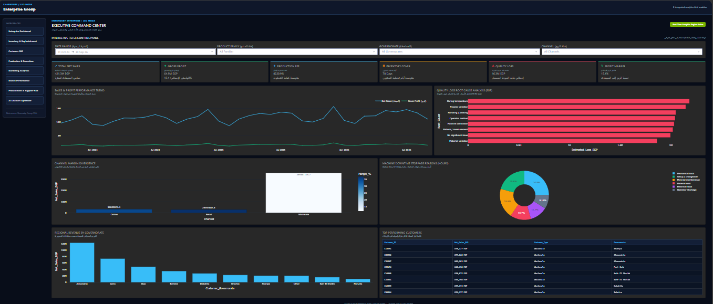
    </td>
    <td width="50%">
      <strong>02 — Smart Inventory & Replenishment</strong><br/>
      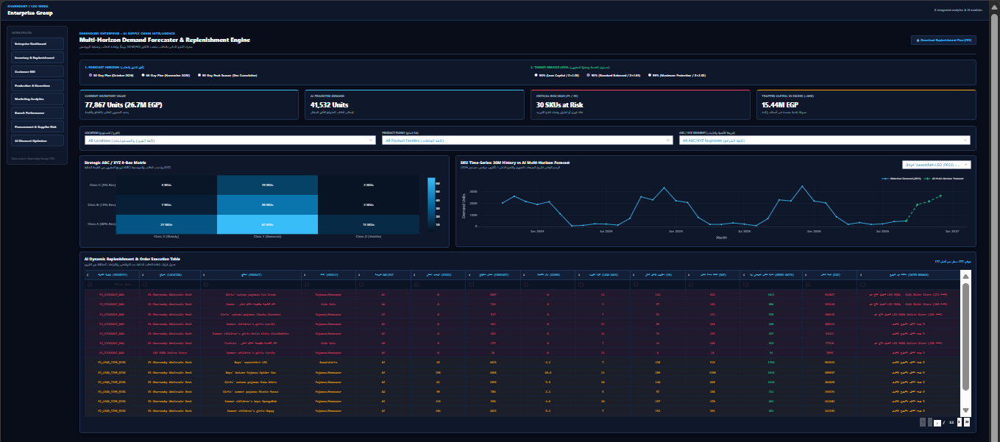
    </td>
  </tr>
  <tr>
    <td width="50%">
      <strong>03 — Customer 360</strong><br/>
      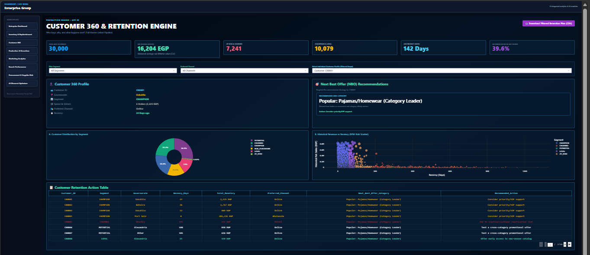
    </td>
    <td width="50%">
      <strong>04 — Production & Downtime</strong><br/>
      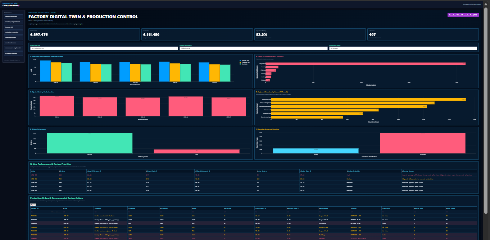
    </td>
  </tr>
  <tr>
    <td width="50%">
      <strong>05 — Marketing Analytics</strong><br/>
      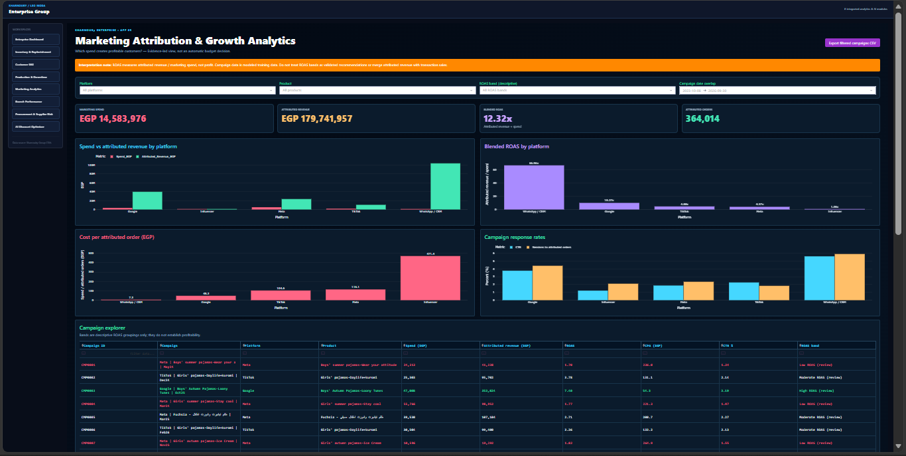
    </td>
    <td width="50%">
      <strong>06 — Branch Performance</strong><br/>
      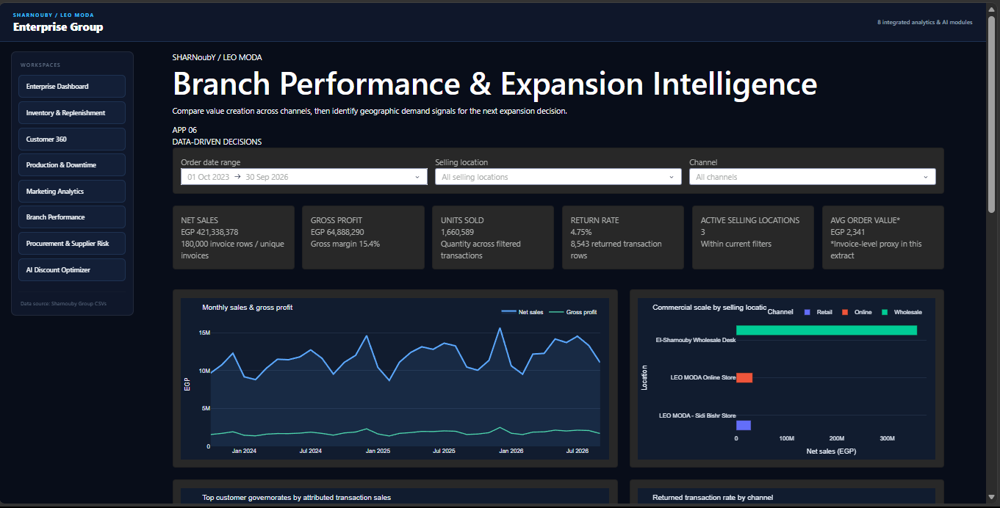
    </td>
  </tr>
  <tr>
    <td width="50%">
      <strong>07 — Procurement & Supplier Risk</strong><br/>
      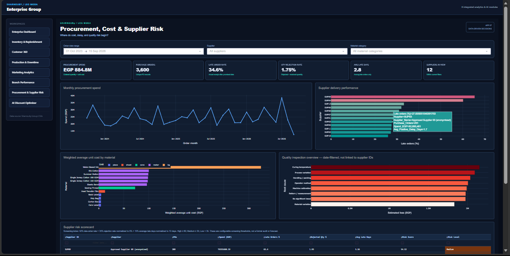
    </td>
    <td width="50%">
      <strong>08 — Discount & Profit Optimizer</strong><br/>
      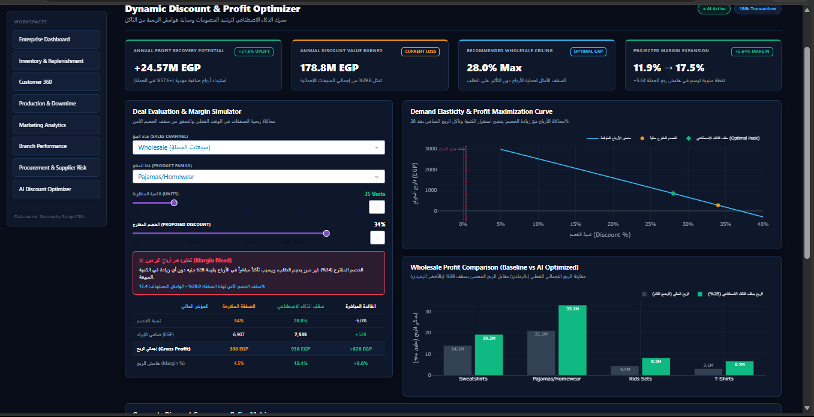
    </td>
  </tr>
</table>

### 🔎 Additional Inventory & Forecasting Insights

**Inventory Replenishment Plan**

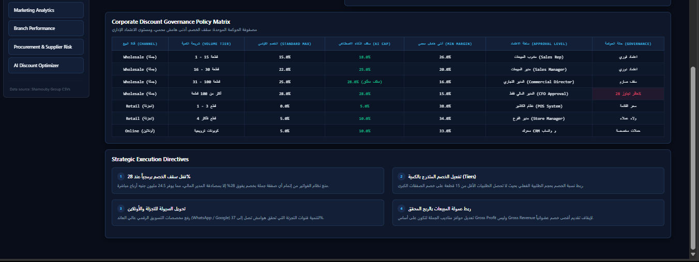

**Demand Forecasting Details**

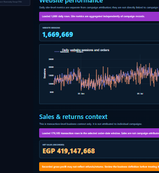

**Forecast Model Performance**

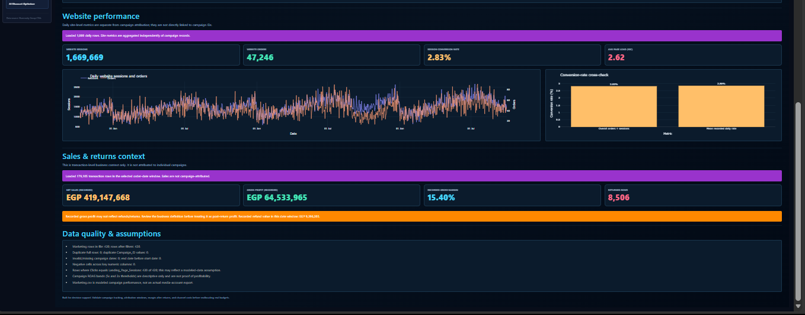

**Branch Location Analysis**

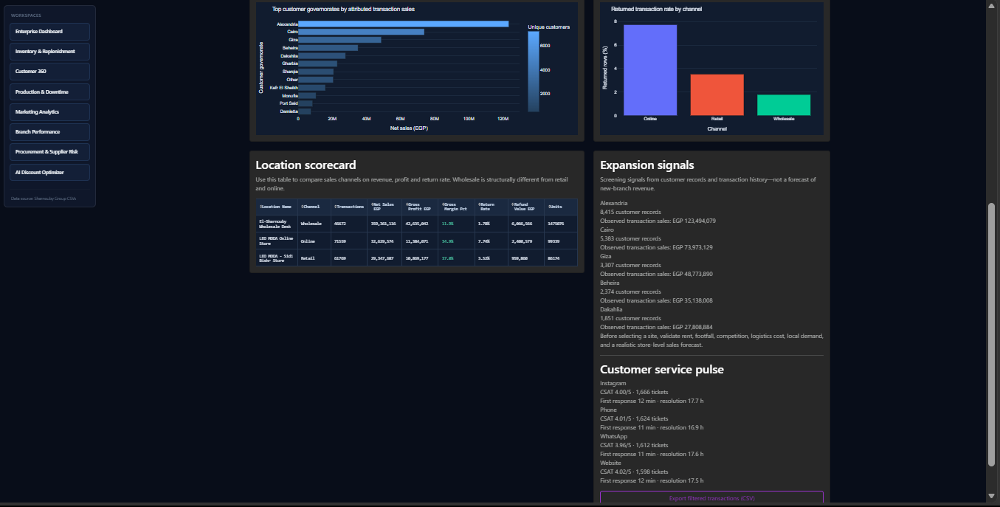


## 🧠 Technology Stack

- **Python** — Core programming language
- **Pandas** — Data processing and analysis
- **Dash** — Interactive web applications
- **Plotly** — Data visualization
- **Scikit-learn** — Machine learning capabilities where applicable
- **CSV datasets** — Business data inputs

## 📦 Project Structure

```text
Sharnouby-Enterprise-Analytics/
├── unified_app.py
├── updata_app.py
├── app2.py
├── app3.py
├── app4.py
├── app5.py
├── app6.py
├── app7.py
├── app8_discount_optimizer.py
└── README.md
```

*Note: Actual data and output folders may vary depending on the local project setup.*

## ⚙️ Getting Started

### Prerequisites
- Python installed on your system
- Required Python packages
- The necessary project datasets and output files

## 📈 Business Value

The platform is designed to help businesses:

- Improve visibility into financial and operational performance.
- Identify inventory shortages and replenishment needs.
- Evaluate demand forecasts and inventory planning decisions.
- Monitor production efficiency and downtime.
- Understand customer and branch performance.
- Evaluate the potential impact of discount strategies.
- Turn raw business data into actionable insights.

## 🔍 Data & Model Validation

Forecasts, recommendations, and analytical outputs should be evaluated against historical data and appropriate validation metrics before being used for operational decisions.

Model performance depends on data quality, feature availability, and the validation methodology.
